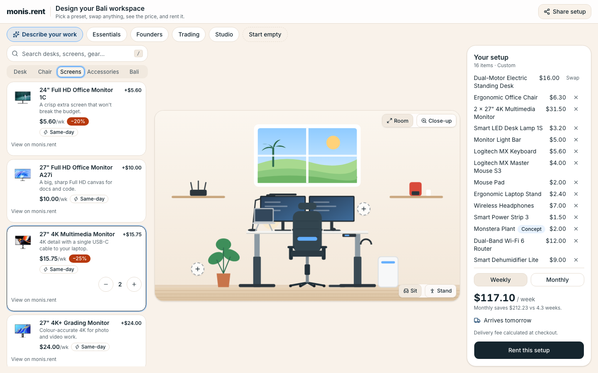
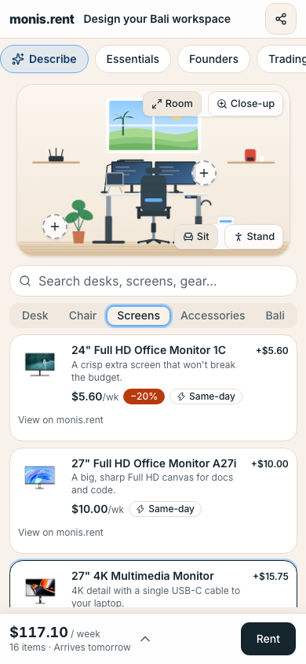

# monis.rent Workspace Builder

**Live:** https://monis-rent-theta.vercel.app

Design your Bali workspace visually, see the price instantly, and rent it. Built for the Desent Solutions developer challenge, for their client [monis.rent](https://www.monis.rent), which rents office equipment to digital nomads and startups in Bali.

| Desktop                                                | Phone                                                |
| ------------------------------------------------------ | ---------------------------------------------------- |
|  |  |

## What you can do

- **Start from a real bundle** (Essentials, Founders, Trading, Studio) or **describe your work** in one sentence ("Video editor in Canggu, 2 months, $120/wk") and get a setup with the reasons behind it, plus Undo.
- **Swap anything:** 3 desks, 3 chairs, 8 screens, lamps, peripherals, plants and Bali extras (Starlink, dehumidifier, coffee). Search finds items across all categories.
- **Watch it come to life:** an SVG scene drawn to scale (1 unit = 1 cm). Items drop in, the desk rises when you switch to standing, and screens line up and angle themselves when the desk gets crowded.
- **Close-up view:** one tap zooms into the desk; drag to look around.
- **Always know the price and timing:** weekly or monthly total, monthly savings, and "can arrive today" or "arrives tomorrow" from the monis.rent delivery data.
- **Tap anything in the scene** (desk, screens, chair, plants, shelves, fans) to jump to it in the list.
- **Undo instead of "are you sure?"**: removing an item or switching preset shows a toast with Undo.
- **Share the setup** as a link, then **rent it** through a checkout with a searchable Bali area list, a calendar and a WhatsApp country code, ending with a clear confirmation.

## Approach

I started from the persona in the brief: a freelancer who just landed in Bali and needs a desk by next week. They ask three things: _what do I get, what does it cost, when does it arrive?_ Every screen answers all three at once.

- **No empty desk.** The builder opens on a sensible setup, because editing is easier than starting from nothing. Presets mirror monis.rent's real bundles.
- **People know their work, not their gear.** Smart setup turns "lots of calls, bad wifi" into a webcam, a headset and a router, and explains why.
- **Phone first.** The page never scrolls. The header stays put, the scene sits on top, items scroll underneath, and the price bar is pinned to the bottom. It also works on tablets, landscape phones and desktops.
- **Honest with a real client's brand.** Prices, photos and delivery rules come from monis.rent (a dated snapshot). Their catalog has one chair and no plants, so two chairs and two plants are clearly marked **Concept**. Checkout says plainly that it is a demo, and no delivery promise is invented.

## Tech choices

- **Next.js 16 (App Router) + Tailwind CSS 4 + shadcn/ui (Radix)**, deployed on **Vercel**. The app is fully static, with no backend, database or secrets.
- **Inline SVG instead of 3D:** polished, light on phones, and fast to iterate. The geometry lives in a pure, tested `layoutScene()`.
- **Pure domain core** (`src/lib`): pricing in integer cents, slot and capacity rules, share links, search, smart setup and checkout validation. React only calls it.
- **Zustand** for state, persisted to `localStorage`. A share link rebuilds any setup.
- **Smart setup is rule-based** on purpose: no API key, no cost, deterministic and tested. `suggestSetup(text, current)` has the same signature an LLM-backed version would need.
- **Quality gate:** strict type-checked ESLint (zero warnings), Prettier, 150+ Vitest unit tests, and Playwright E2E on desktop and mobile with axe accessibility checks. A layout test proves the page fits nine screen sizes without scrolling. CI runs all of it on every push.

## What I'd improve with more time

- **Live catalog:** read products, prices and stock from monis.rent's Strapi API instead of a snapshot, including the real bundle discount.
- **Real checkout:** hand the setup to the monis.rent cart, or send it via WhatsApp, with a delivery-fee estimate by area.
- **An LLM behind smart setup** (same interface), with the rule-based version as a fallback.
- **Richer scene:** more art variants per product and drag-to-reorder screens.
- **Analytics** on which presets and items people pick, to inform monis.rent's catalog (for example, offering more chairs).

## Run it locally

Requires Node.js 22+ and pnpm.

```bash
pnpm install
pnpm dev            # http://localhost:3000
```

Quality checks:

```bash
pnpm lint && pnpm type-check && pnpm format:check && pnpm test
pnpm build && pnpm test:e2e     # serves the build on :3100
```

## Docs

- [Design spec](docs/superpowers/specs/2026-10-11-workspace-builder-design.md) and [implementation plans](docs/superpowers/plans/)
- [Architecture](docs/overview/architecture.md) · [Deployment](docs/overview/deployment.md)
- [Challenge brief and must-haves](docs/product/brief.md) · [Catalog notes](docs/product/catalog-notes.md)
- [QA rounds](docs/qa/) · [Bug log](docs/bugs/bug-log.md)

## Support

Built by eksant. If this was useful, [buy me a coffee](mailto:eksant@gmail.com?subject=A%20coffee%20for%20the%20monis.rent%20builder).

## License

The code is [MIT](LICENSE)-licensed. The MIT grant does not cover monis.rent product names, prices or photos (in `src/data/catalog.ts` and on `strapi.monis.rent`). They belong to monis.rent and are used here for the challenge only.
